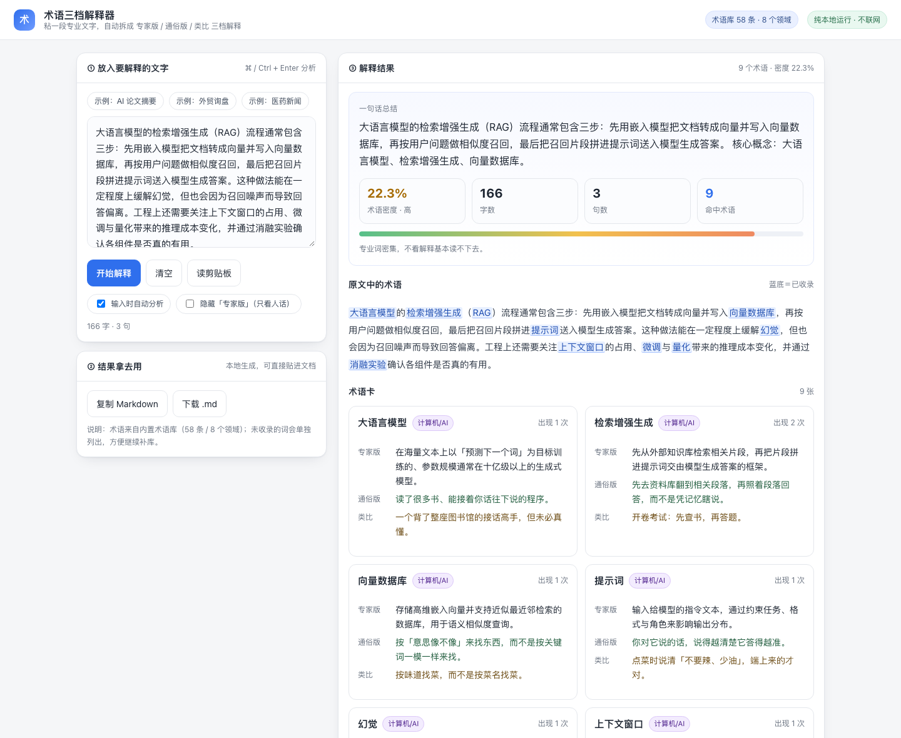

# 术语三档解释器

把一段看不懂的专业文字，先改写成一整段**带人话注解的版本**，再把每个生词拆成 **专家版 / 通俗版 / 类比** 三档解释，顺手给出术语卡和一句话总结。

2026 软工实践周参赛作品（高级组 · 单人组），主题：跨域知识探索。



## 它解决什么问题

读跨专业材料时，最耗时间的不是理解，而是**卡在术语上**：一个词不认识，就要开三个窗口（翻译、搜索引擎、问模型），读完一段还要回头重看。结果是一页正文读半小时。

这个工具把这件事压成一步：整段贴进来，标出所有专业词，每个词给三档解释——专家版的精确定义、通俗版的一句话人话、类比版的生活化对照。三档并排看，比单看一种解释更容易建立直觉。

## 怎么用

1. 双击 `index.html`，用浏览器打开（不用装任何东西、不用起服务、不联网）
2. 左边粘一段文字，或者点一个示例
3. 右边立刻得到：一句话总结、**整段人话版**、术语密度、原文标词、逐词三档解释
4. 「复制 Markdown」贴进笔记，「下载 .md」存成本地文件

也可以直接把 `.txt` / `.md` 文件拖进输入框，或在地址后加 `#s0`、`#s1`、`#s2` 直接打开内置示例。

## 功能一览

- **术语识别**：中文术语按最长优先匹配（`检索增强生成` 不会被切成 `检索` + `生成`），英文别名支持 `LLM`、`RAG`、`FOB`、`CIF` 等缩写
- **三档解释**：每张卡给「专家版 / 通俗版 / 类比」，可一键隐藏专家版，只留人话
- **术语密度**：命中术语的字数占比，据此给出低 / 中 / 高门槛判断和一句建议
- **整段人话版**：把命中的每个术语原地补一句人话（`双盲试验（医生和病人都不知道吃的啥）`），句子结构不动，整段能直接读下去；括号里的英文别名会合并成 `（RAG，先查资料再回答）`
- **一句话总结**：抽取首句 + 出现最多的三个术语，快速判断这段值不值得细读
- **未收录候选**：术语库外的缩写（如 `SBERT`、`FAISS`）单独列出，提示继续补库
- **导出**：Markdown 复制与下载，方便沉淀到自己的笔记
- **纯本地**：没有后端、没有依赖、没有网络请求，文本不出浏览器

## 目录结构

```
作品/
├── index.html              # 界面（单文件，直接打开即用）
├── engine.js               # 核心引擎：术语库 + 匹配 + 三档解释 + 密度 + 总结
├── samples/                # 三个示例文本
├── docs/                   # 界面截图（README 用）
└── tools/
    └── test_engine.mjs     # 引擎单元测试（Node 运行）
```

## 术语库

当前 **58 条**术语，覆盖 **8 个领域**：

| 领域 | 条数 | 例子 |
|---|---|---|
| 计算机 / AI | 11 | 检索增强生成、向量数据库、幻觉、上下文窗口 |
| 金融经贸 | 13 | 信用证、离岸价、原产地证、滞期费 |
| 生物医药 | 7 | 双盲试验、生物标志物、半衰期 |
| 气候能源 | 7 | 碳中和、光伏、电网调峰、生命周期评估 |
| 数据库 | 5 | 事务、范式、分片 |
| 编译原理 | 5 | 抽象语法树、寄存器分配 |
| 科研方法 | 6 | 显著性、消融实验、元分析 |
| 软件工程 | 4 | 技术债、持续集成、回归测试 |

每条都是一条记录：术语名、领域、别名（中英）、三档解释。加新词只改 `engine.js` 顶部的 `GLOSSARY` 数组，界面和导出自动跟上。

## 技术实现

纯前端三件套，没有框架和构建步骤，任何浏览器双击就能跑。

1. **匹配**：中文字符串直接 `indexOf` 扫描；英文别名走带边界断言的正则（`(^|[^A-Za-z0-9_])词(?![A-Za-z0-9_])`），所以 `LLM2` 不会被误判成 `LLM`。所有命中按起点排序、同起点取最长，再做一次区间去重，保证不重叠、不切碎。
2. **密度**：命中区间覆盖的字符数 ÷ 去空白后的总字数，分档 5% / 12% 给出低 / 中 / 高。
3. **总结**：正则取首句（上限 90 字），拼上词频最高的三个术语。
4. **未收录候选**：只收全大写缩写、带数字的型号和引号内的短语，普通英文单词不当作术语，避免噪声。
5. **高亮**：按命中区间在原串上切片拼 HTML，只转义不重排，保证标点、换行和原文完全一致。

## 测试

```bash
node tools/test_engine.mjs
```

38 项断言，覆盖术语库完整性、最长优先匹配、英文边界、密度分级、总结抽取、整段人话版（注解数量、别名合并、未命中保持原文）、未收录候选、高亮不丢字符和空输入边界。

## 已知局限

- 术语库是人工维护的固定集合，覆盖面有限；未收录的词只能标出来，不会自动解释
- 同形异义未处理：`期权` 在金融语境是合约，在其他语境可能不是
- 中英混排时以词形匹配为主，没有做词性消歧
- 设计上预留了「接大模型补解释」的位置，但为保证演示零故障，当前版本完全离线，不调用任何模型

## 后续可以做什么

- 术语库扩到千条级，并按领域分包按需加载
- 同形异义消歧：用上下文判断词义，而不是只认字面
- 支持整段 PDF 直接拖入（当前需先转成文本）
- 导出成 Anki 卡片格式，直接进复习流程

## 作者

张天翔（24305092），单人组。
